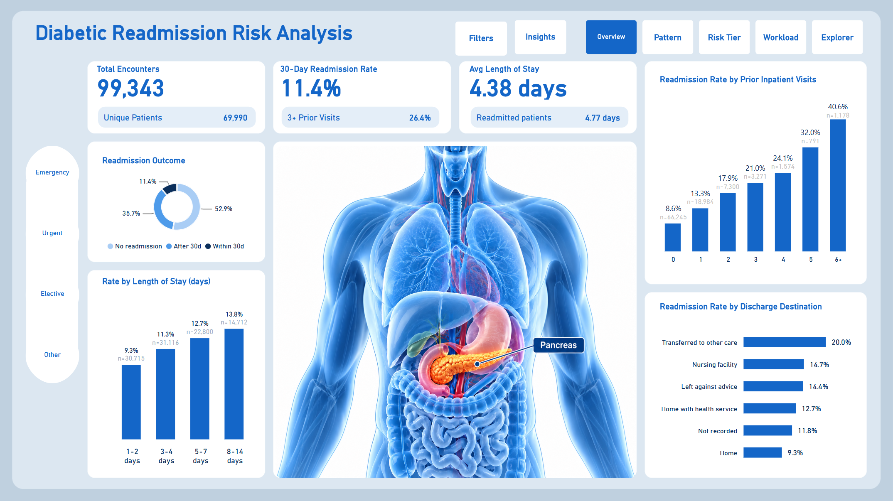
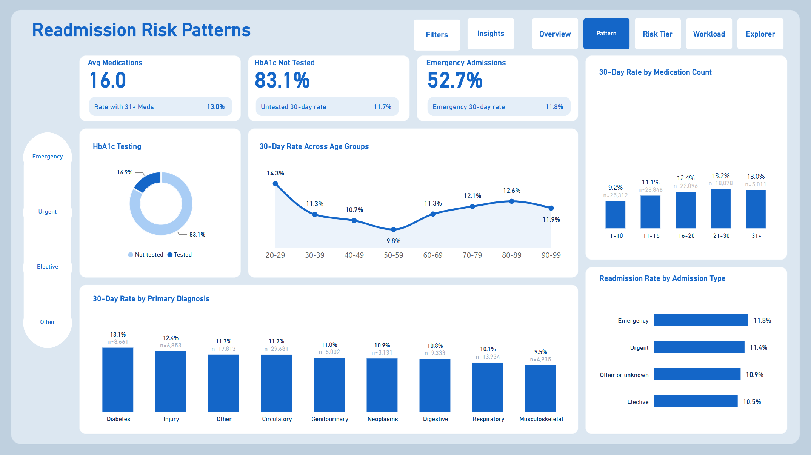

# Diabetic 30-Day Readmission Analysis

Identifying which diabetic patients are at elevated risk of readmission before they leave hospital, and where a limited care-coordination budget would do the most good.



## The business problem

Meridian Care Network (a fictional healthcare network) has seen diabetic readmissions flagged again by its quality committee. The VP of Population Health asked for three things:

1. **Number:** how often are diabetic patients readmitted within 30 days?
2. **Pattern:** which characteristics are associated with higher readmission rates?
3. **Action:** where should a limited care-coordination team focus its time?

The aim was not another chart showing that the number went up, but something the discharge planning team can use on a Tuesday morning.

## Key findings

| | Finding |
|---|---|
| **Baseline** | 11,314 of 99,343 included encounters (11.4%) were readmitted within 30 days |
| **Concentration** | Patients with 2 or more encounters are 23.4% of patients but 79.8% of readmissions |
| **Strongest signal** | The rate rises from 8.6% with no prior inpatient visits to 40.6% with 6 or more |
| **Second signal** | Encounters transferred to other care had a 20.0% rate, compared with 9.3% for those discharged home |
| **Weak signals** | Age, diagnosis group, admission type, medication count and length of stay each move the rate by only a few points |
| **Risk tier** | Encounters with 2+ prior inpatient visits are 14.2% of encounters but hold 27.5% of readmissions (22.0% rate vs 9.6% for everyone else) |
| **Workload** | Coordinating the tier needs about 9,409 staff hours, against 66,229 for everyone: 3.0 hours per readmission reached instead of 5.9 |

All findings are **associations observed in historical data**, not causes.

## Recommendation

Flag encounters with **2 or more prior inpatient visits** at discharge and prioritise them for care-coordination follow-up. The rule is simple enough to apply without a model, it held up on patients the rule was not built on, and it reaches more than a quarter of readmissions for around a seventh of the workload.

Two alternatives are costed for different budgets: **1+ visits** reaches 49.7% of readmissions for 22,065 hours, and **3+ visits** reaches 15.9% for 4,543 hours.

The share of patients flagged differs by race (from 6.7% to 15.8%), so the tier should be reviewed regularly for fairness before and after use.

## Data

| | |
|---|---|
| **Source** | [Diabetes 130-US Hospitals for Years 1999-2008](https://archive.ics.uci.edu/dataset/296/diabetes+130-us+hospitals+for+years+1999-2008), UCI Machine Learning Repository |
| **Citation** | Clore, J., Cios, K., DeShazo, J. and Strack, B. (2014). DOI: [10.24432/C5230J](https://doi.org/10.24432/C5230J) |
| **Licence** | CC BY 4.0 |
| **Size** | 101,766 inpatient encounters, 50 columns, 71,518 unique patients, 130 US hospitals |
| **Lookup file** | IDS_mapping.csv, holding three code tables (admission type, discharge disposition, admission source) stacked in one file |
| **Grain** | One row is one hospital encounter, not one patient |

**Outcome:** an encounter counts as readmitted when `readmitted = "<30"` (readmitted within 30 days of discharge). Readmissions after 30 days are treated as not readmitted.

**Exclusions:** 2,423 encounters ending in death (discharge codes 11, 19, 20, 21) or hospice (13, 14) are excluded, because these patients cannot or are very unlikely to return. This leaves **99,343 included encounters from 69,990 patients**.

## Tools

- **MySQL 8 (MySQL Workbench):** loading, cleaning, modelling, quality checks and analysis
- **Power BI Desktop:** Power Query, DAX measures and the interactive dashboard
- **GitHub:** version control and hosting the diagnosis images used in the dashboard

## Method

The SQL scripts run in order, each building on the last:

| File | What it does |
|---|---|
| `01_load_raw.sql` | Loads both CSV files into text-only staging tables, exactly as they arrive |
| `02_clean.sql` | Splits the mapping file into three lookup tables, converts data types, standardises missing values and flags exclusions |
| `03_model.sql` | Builds a star schema with analysis bands (age, length of stay, prior visits, medications, diagnosis group) and unpivots the 23 drug columns into a medication fact table |
| `04_quality_checks.sql` | Checks row counts, nulls, duplicates and referential integrity, then adds primary keys and indexes |
| `05_risk_tier.sql` | Compares tier cutoffs, validates the chosen tier on held-out patients, builds the capture curve and estimates workload |
| `06_analysis.sql` | Ten exploratory questions behind the dashboard insights |

SQL techniques used include CTEs, window functions (`ROW_NUMBER`, `RANK`, `SUM OVER`), `CASE`, `COALESCE`, joins, `CROSS JOIN` for unpivoting, primary keys and indexes.

### Data model

A star schema with two fact tables:

- **fact_encounter:** one row per encounter (101,766 rows), with the outcome, exclusion flag, analysis bands and tier flag
- **fact_medication:** one row per encounter per drug prescribed (120,054 rows)
- **Dimensions:** dim_admission_type, dim_discharge_disposition, dim_admission_source, dim_diag_group, dim_drug

### Data cleaning decisions

| Issue | Decision |
|---|---|
| `?` used for missing values | Converted to NULL or "Unknown", depending on the column |
| `None` in the HbA1c field means the test was not done | Relabelled "Not tested" rather than treated as missing (83.1% of included encounters) |
| `weight` is almost entirely missing | Column dropped |
| `examide` and `citoglipton` hold a single value | Columns dropped |
| Mapping file has three tables stacked in one | Split by line position into three lookup tables |
| Admission type 6 is labelled "NULL" in the mapping | Relabelled "Not recorded". With "Not Available" and "Not Mapped", 10.2% of encounters have no usable admission type |
| Raw files use Windows line endings | Loaded with `LINES TERMINATED BY '\r\n'` |

### Risk tier and validation

Patients were split by `patient_nbr` into a 70% build group and a 30% test group (`MOD(patient_nbr, 10) < 7`), so no patient appears in both. Cutoffs of 1+, 2+ and 3+ prior inpatient visits were compared on the build group, and **2+** was chosen as the best balance of reach and workload.

| | All data | Held-out test patients |
|---|---|---|
| Tier rate vs rest (lift) | 2.29 times higher | 2.07 times higher |
| Share of readmissions captured | 27.5% | 25.6% |

This is an **explainable analytical flag based on observed patterns**. It is not a clinically validated prediction model, not a diagnosis and not a replacement for clinical judgement.

### Workload assumptions

Staff hours assume **2 contacts per patient at 20 minutes each**. Both values are adjustable with what-if sliders on the Workload page of the dashboard.

## Dashboard

Five pages, built in Power BI:

| Page | Question it answers |
|---|---|
| **Overview** | How big is the problem? |
| **Patterns** | Which characteristics go with higher rates? |
| **Risk Tier** | Who should be flagged, and how well does the flag work? |
| **Workload** | What would targeting the tier cost in staff time? |
| **Explorer** | How do the patterns look within each diagnosis group? |

Interactive features include an admission type filter synced across all pages, a Filters panel (age, discharge destination, HbA1c testing), an Insights panel on every page, what-if sliders, and diagnosis buttons with matching images. Rates based on fewer than 30 encounters are hidden so small groups do not mislead.

| | |
|---|---|
|  |  |
|  |  |

The full DAX measure list is in [`powerbi/dax_measures.txt`](powerbi/dax_measures.txt), and the Power Query steps are in [`powerbi/power_query/`](powerbi/power_query/).

## Repository structure

```
Hospital-readmissions/
├── README.md
├── data/
│   ├── raw/            original UCI files
│   └── clean/          the seven tables exported from MySQL
├── sql/                01_load_raw.sql to 06_analysis.sql
├── powerbi/            .pbix, PDF, DAX measures, Power Query screenshots
├── Powerbi_Screenshots/ dashboard pages
├── images/             diagnosis group images used in the Explorer page
└── docs/               report, slides, data dictionary, cleaning log
```

## How to reproduce

1. Download the dataset from UCI (link above) into `data/raw/`.
2. In MySQL 8, enable local file loading (`SET GLOBAL local_infile = 1;`).
3. Update the file paths at the top of `01_load_raw.sql`, then run the scripts `01` to `06` in order.
4. Open `powerbi/Meridian_Readmissions_Dashboard.pbix` in Power BI Desktop. If prompted, point the data source to the CSV files in `data/clean/` (Transform data, then Data source settings).

## Limitations

- **Association, not causation.** The patterns describe what was observed, not why it happened.
- **Historical data.** Encounters date from 1999 to 2008, so absolute rates may not reflect current practice.
- **No admission dates.** `encounter_id` is used as a stand-in for visit order.
- **Readmissions are only those recorded** in this dataset. Returns to other hospitals are not captured.
- **Encounters, not patients.** Most figures count encounters, and one patient can appear several times.
- **Concentration is partly built in.** Patients who are readmitted naturally have more encounters on record.
- **Fairness.** The share of encounters flagged varies by race, so the tier needs monitoring if used.

## Author

[Your name] · [LinkedIn or portfolio link]
