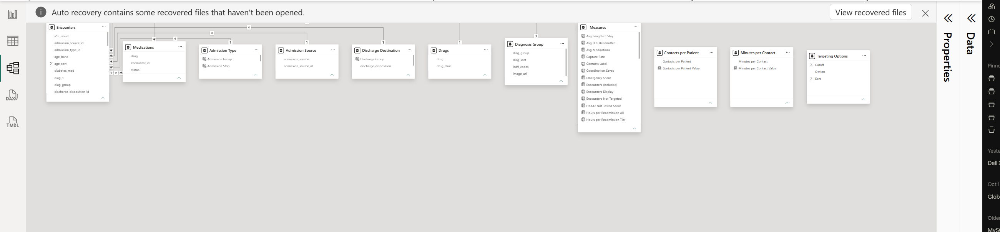
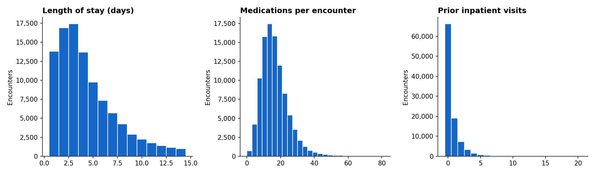
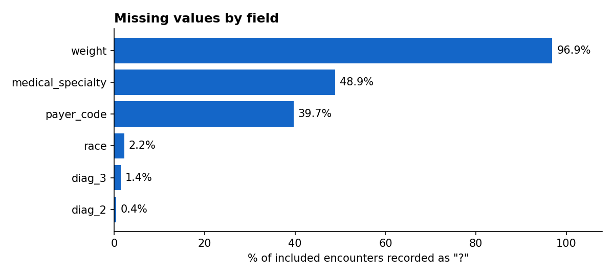
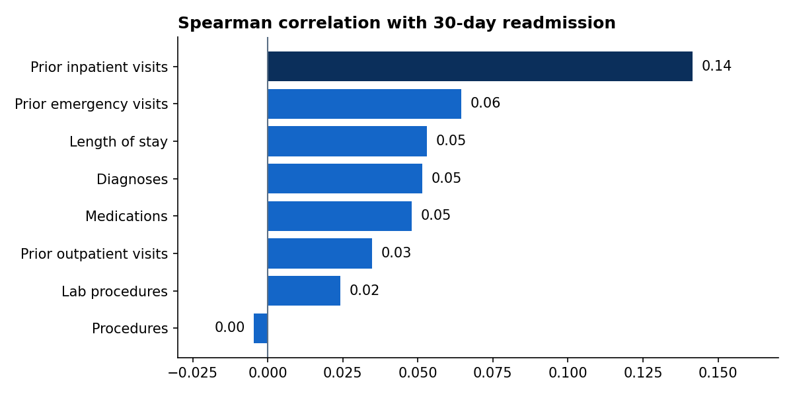
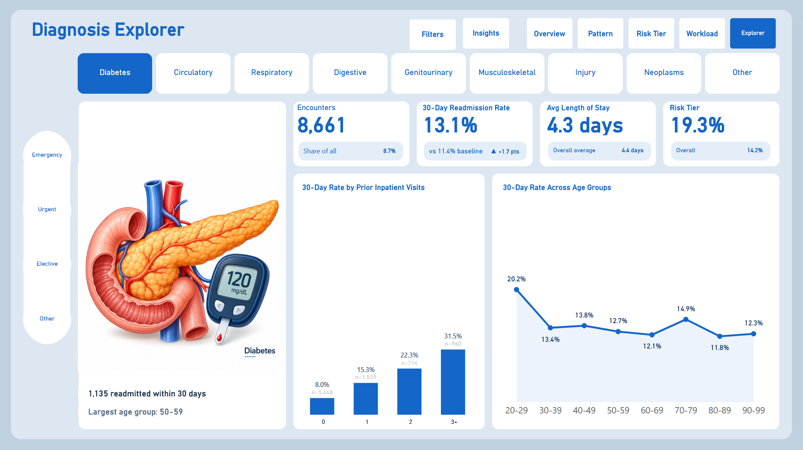
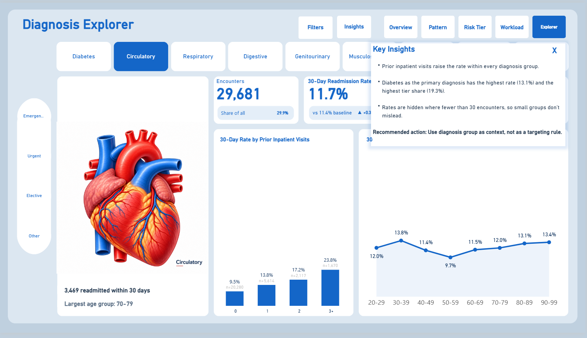
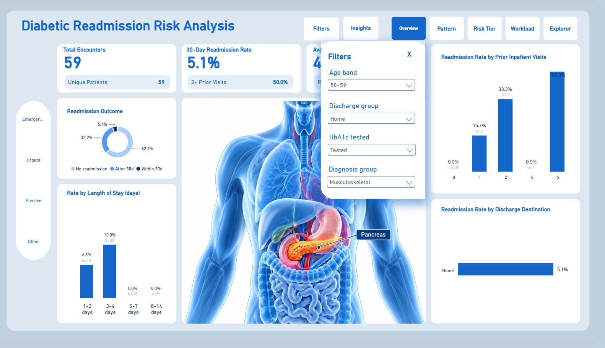

# Diabetic 30-Day Readmission Analysis

Finding which diabetic patients are most likely to return to hospital within 30 days of discharge, and estimating how much staff time a targeted follow-up programme would need.

**Tools:** MySQL · Python (Google Colab) · Power BI


## Table of contents

1. [Executive summary](#1-executive-summary)
2. [Project overview](#2-project-overview)
3. [Data source](#3-data-source)
4. [Problem statement](#4-problem-statement)
5. [Tools and methodology](#5-tools-and-methodology)
6. [Exploratory data analysis](#6-exploratory-data-analysis)
7. [Key insights](#7-key-insights)
8. [Dashboard preview](#8-dashboard-preview)
9. [Recommendations](#9-recommendations)
10. [Limitations](#10-limitations)
11. [Implementation](#11-implementation)
12. [Conclusion](#12-conclusion)
13. [Relevant links](#13-relevant-links)

## 1. Executive summary

This project analyses 99,343 hospital stays by patients with diabetes to answer one practical question: with limited staff time, which patients should a care team follow up after discharge? About 1 in 9 stays (11.4%) was followed by a readmission within 30 days. The clearest warning sign was a patient's number of inpatient stays in the previous year. A simple flag, **two or more stays in the past year**, picks out 14.2% of stays, which hold 27.5% of all readmissions, at a rate of 22.0% compared with 9.6% for everyone else. Following up only this group would take an estimated 86% fewer contact hours than following up every stay. The recommended next step is a small pilot to test whether follow-up actually reduces readmissions.

## 2. Project overview

**Domain:** healthcare, population health and hospital discharge planning.

**Business context:** Meridian Care Network is a fictional healthcare network used for this case study. Its quality committee flagged diabetic readmissions as a concern. The network has a care-coordination team that can contact patients after they leave hospital, but it does not have the capacity to contact everyone.

**Why it matters:** a readmission within 30 days is a common measure of hospital quality, and some readmissions may be preventable with better follow-up. The VP of Population Health did not want another report showing that the number had gone up. They wanted a clear way for discharge staff to decide who receives follow-up, and an estimate of what it would cost in staff time.

## 3. Data source

The data is the [Diabetes 130-US Hospitals for Years 1999-2008](https://archive.ics.uci.edu/dataset/296/diabetes+130-us+hospitals+for+years+1999-2008) dataset from the UCI Machine Learning Repository (Clore et al., 2014, DOI [10.24432/C5230J](https://doi.org/10.24432/C5230J), CC BY 4.0). It contains 101,766 hospital stays from 71,518 patients across 130 US hospitals, recorded between 1999 and 2008, with 50 columns covering patient details, admission and discharge, diagnoses, tests, medications and readmission. It is de-identified clinical record data.

A second file, `IDS_mapping.csv`, translates the code numbers for admission type, discharge destination and admission source into readable labels.

| | |
|---|---|
| **Rows** | 101,766 hospital stays |
| **Columns** | 50 |
| **Patients** | 71,518 |
| **Hospitals** | 130 (United States) |
| **Period** | 1999 to 2008 |
| **One row means** | One hospital stay (an "encounter"), not one patient. The same patient can appear several times |

**Limitations of the data:** it is historical, it has no admission dates, it may not capture readmissions to hospitals outside the dataset, and some fields are mostly empty (for example, weight is 96.9% missing).

## 4. Problem statement

Diabetic readmissions had been flagged again, and the care-coordination team needed to know where to focus its limited time. The project set out to answer three questions:

- **The number:** how often are diabetic patients readmitted within 30 days?
- **The pattern:** which recorded characteristics go with higher readmission rates?
- **The action:** how could the team target its time, and how much work would that involve?

**What counts as a readmission:** a stay counts as readmitted when the dataset records a return within 30 days of discharge (`readmitted = "<30"`). Returns after 30 days, and stays with no recorded return, both count as not readmitted.

## 5. Tools and methodology

| Tool | How it was used |
|---|---|
| **MySQL 8** | Loading, cleaning, building the data model, quality checks and the main analysis queries |
| **Python (Google Colab)** | Summary statistics, outliers, missing values, correlation, a significance test and charts ([`eda_stats.ipynb`](eda_stats.ipynb)) |
| **Power BI** | Power Query, DAX measures and a five-page interactive dashboard |

### Workflow

```
Raw files ─► Load ─► Clean ─► Model ─► Quality checks ─► Analysis ─► Risk flag ─► Dashboard ─► Recommendations
```

### Data collection

Both files were downloaded from the UCI repository and loaded into MySQL exactly as they arrived, using text-only staging tables, so nothing was changed before it could be checked ([`01_load_raw.sql`](sql/01_load_raw.sql)).

### Data cleaning and preparation

Most cleaning was done in [`02_clean.sql`](sql/02_clean.sql), which also creates the 30-day readmission flag and the exclusion flag. A small number of label changes were made in Power Query. Each decision is recorded in the [cleaning log](docs/cleaning_log.md).

| Issue found | What was done |
|---|---|
| `?` used to mean missing | Changed to "Unknown" for descriptive fields and to empty (NULL) for diagnosis codes |
| "None" in the HbA1c test field means the test was not done | Relabelled "Not tested" rather than treated as missing |
| Weight is 96.9% missing | Left out of the clean table |
| Two medication columns hold only one value | Left out, as they carry no information |
| The lookup file holds three tables stacked in one | Split into three separate tables |
| Admission type 6 is labelled "NULL" in the lookup file | Relabelled "Not recorded" in Power Query (Power BI). Together with "Not Available" and "Not Mapped", 10.2% of stays have no usable admission type |
| Patients who died (1,652 stays) or went to hospice (771 stays) | Flagged and left out of the analysis. Patients who died cannot be readmitted, and hospice care has different goals, so both were treated as outside the scope of a readmission-prevention programme. The rows were kept so they can still be inspected |

After exclusions, the analysis covers **99,343 stays from 69,990 patients**.

### Data transformation and processing

In [`03_model.sql`](sql/03_model.sql):

- Age, length of stay, prior inpatient visits and number of medications were grouped into bands, each with a sort order so charts display correctly.
- More than 700 primary diagnosis codes were grouped into nine diagnosis groups.
- The 21 medication columns were reshaped into one table with a row for each stay and drug where the medication status was not "No" (120,054 rows). This table includes excluded stays, so they are filtered out where needed.
- The readmission and exclusion flags created during cleaning were carried into the model.

### Calculated fields and DAX measures

The Power BI model includes DAX measures for the readmission rate, flagged-group rate, rate for everyone else, share of readmissions captured, staff hours and hours per readmission reached. A measure called Rate (min 30) hides rates for groups with fewer than 30 stays. It is used on the two Explorer page charts, where diagnosis groups can be very small. Every rate counts included stays only. The full list is in [`PowerBi/dax_measures.txt`](PowerBi/dax_measures.txt).

### Data validation

[`04_quality_checks.sql`](sql/04_quality_checks.sql) checks row counts, missing values and duplicates, then adds keys and indexes. [`03_model.sql`](sql/03_model.sql) checks that every stay links to its lookup tables.

- Row counts matched between the raw and modelled tables (101,766).
- There were no duplicate stays and no stays without a matching lookup value.
- The headline figures (99,343 stays, 11,314 readmissions, 11.4%) matched across SQL, Python and Power BI.

### Data modelling

A star schema with two fact tables, hospital stays (`fact_encounter`) and medications (`fact_medication`), and five lookup tables. Admission type, admission source, discharge destination and diagnosis group link to the hospital stays table, and the drug table links to the medications table. The medications table links to hospital stays by stay ID.



*The data model in Power BI. Admission type, admission source and discharge destination link by their code fields. Diagnosis group links by group name, and Drugs links to Medications by drug name.*

### Data visualisation

A five-page interactive Power BI dashboard was built to answer the stakeholder's three questions, from the size of the problem through to the staff time needed. See [section 8](#8-dashboard-preview).

## 6. Exploratory data analysis

The exploratory analysis was done in SQL ([`06_analysis.sql`](sql/06_analysis.sql), ten questions) and Python ([`eda_stats.ipynb`](eda_stats.ipynb)). Query results are in [`sql/Sample_Outputs.docx`](sql/Sample_Outputs.docx), and the full write-up is in the [EDA report](docs/eda_report.md).

**Key patterns.** The readmission rate rises steadily with the number of inpatient stays in the previous year. Other characteristics, such as age, diagnosis group and admission type, show much smaller differences.

**Distributions.** Most stays were short and used a moderate number of medications (median 4 days and 15 medications). Both are right-skewed, with a long tail of longer, more complex stays. More than half of stays had no inpatient stay in the previous year.



**Trends.** The data has no dates, so trends over time cannot be measured. This also means the analysis cannot show when any increase in readmissions started.

**Outliers.** Some patients had very high numbers of earlier visits, up to 76 emergency visits and 21 inpatient stays. These values are plausible for frequent attenders, so they were kept and placed in open-ended bands such as "6+". The data does not allow them to be independently confirmed.

**Missing values.** Weight (96.9%), medical specialty (48.9%) and payer code (39.7%) are the most incomplete fields. Race is missing for 2.2% of stays.



**Correlations.** Of the eight numeric fields tested, the number of inpatient stays in the previous year had the strongest relationship with readmission (Spearman correlation 0.14). This is a modest relationship, but more than twice as strong as any other field.



## 7. Key insights

All insights describe **patterns in historical data, not causes**. Each comparison looks at one characteristic at a time.

**1. Previous hospital stays are the clearest warning sign.**
*What happened:* the 30-day readmission rate rises from 8.6% for patients with no inpatient stays in the previous year to 40.6% for those with six or more.
*Why:* repeated stays may reflect more complex or less stable health.
*Why it matters:* this information is already in the patient record, so discharge staff can use it without collecting anything new.

**2. Readmissions are concentrated in a smaller group of patients.**
*What happened:* patients with two or more stays in the data make up 23.4% of patients but account for 79.8% of readmissions.
*Why:* part of this is built in, because a readmission is itself another stay. Even so, the problem is not spread evenly across patients.
*Why it matters:* a concentrated problem can be targeted, which suits a team that cannot contact everyone.

**3. A simple flag separates higher-risk stays, and holds on other patients.**
*What happened:* stays where the patient had two or more inpatient stays in the previous year had a 22.0% readmission rate, compared with 9.6% for the rest. A chi-square test, which checks whether a difference is larger than chance alone would produce, gave 1,841.5 (p < 0.001). When patients were split by ID into a 70% group and a 30% group, so that no patient appeared in both, the flagged rate was 2.38 times the rest in the first group and 2.07 times in the second.
*Why:* the flag is built on the strongest single signal in the data.
*Why it matters:* the pattern is consistent across separate groups of patients, so it is not simply a feature of one sample.

**4. Targeting roughly halves the staff time per readmission reached.**
*What happened:* contacting every stay would take an estimated 66,229 hours, or 5.9 hours per readmission reached. Contacting only the flagged group would take 9,409 hours, or 3.0 hours per readmission reached.
*Why:* the flagged group is small (14.2% of stays) but holds a large share of readmissions (27.5%).
*Why it matters:* a limited budget reaches more of the patients at highest risk.

**5. Discharge destination shows a large difference, but needs a closer look.**
*What happened:* stays where the patient went home had a 9.3% readmission rate. A combined group of all other discharge codes not listed separately, which includes transfers to other hospitals and care facilities, had 20.0%.
*Why:* patients moving between services may have higher needs, but this group mixes several types of discharge.
*Why it matters:* it is a promising lead, but it needs to be broken down before it can guide practice.

**6. Most other characteristics make only a small difference.**
*What happened:* length of stay (9.3% to 13.8%), number of medications (9.2% to 13.2%), diagnosis group (9.5% to 13.1%), age for adults aged 30 to 99 (9.8% to 12.6%) and admission type (10.5% to 11.8%) each shift the rate by less than five percentage points.
*Why:* looked at one at a time, these characteristics show much smaller differences than previous hospital use.
*Why it matters:* they are useful context for a care plan. Whether they would improve targeting in combination with previous stays was not tested.

## 8. Dashboard preview

Five interactive pages, built in Power BI:

| Page | What it answers |
|---|---|
| **Overview** | How big is the problem? |
| **Patterns** | Which characteristics go with higher rates? |
| **Risk Tier** | Who would be flagged, and how well does the flag separate risk? |
| **Workload** | What would different options cost in staff time? |
| **Explorer** | Do the patterns hold within each diagnosis group? |

**KPI cards:** stays, unique patients, 30-day readmission rate, average length of stay, share of stays flagged, flagged-group rate, share of readmissions captured, staff hours and hours per readmission reached.

**Filters and interaction:** an admission type filter that stays in sync across every page, a filters panel on each page (age, discharge destination and HbA1c testing, plus diagnosis group on four pages), an insights panel on each page, sliders for the workload assumptions and diagnosis group buttons on the Explorer page. The insights panel text is fixed: it describes the full dataset at the default settings and does not change when filters or sliders change.

| | |
|---|---|
|  |  |
|  |  |

| | |
|---|---|
|  |  |
| *The insights panel summarises each page in plain language, using whole-dataset figures* | *The filters panel narrows the charts on the page* |

**Workload assumptions:** staff hours assume two follow-up contacts of 20 minutes each for every eligible discharge. A patient with several eligible stays is counted once for each discharge. Both values can be changed with the sliders on the Workload page. The slider is labelled "contacts per patient", but the calculation applies it to each discharge.

## 9. Recommendations

**1. Pilot the 2+ flag at discharge** (insights 1, 3 and 4).
Add "inpatient stays in the past 12 months" to the discharge checklist on one ward, and give each flagged discharge two follow-up contacts within 30 days. The flag uses information already in the record, needs no software, and anyone can see why a patient was flagged. *Expected impact:* in this data, the flagged group held 27.5% of readmissions, for an estimated 86% fewer contact hours than contacting every stay.

**2. Match the cutoff to the team's capacity** (insight 4).
Start with 2+. If capacity is tighter, the 3+ option reaches 15.9% of readmissions for an estimated 4,543 hours. With more capacity, the 1+ option reaches 49.7% for 22,065 hours. *Expected impact:* the team can choose a level of coverage it can actually deliver.

| Who gets follow-up | Stays | Share of readmissions reached | Estimated contact hours | Hours per readmission reached |
|---|---|---|---|---|
| Every stay | 99,343 | 100% | 66,229 | 5.9 |
| 1+ prior stays | 33,098 | 49.7% | 22,065 | 3.9 |
| **2+ prior stays** | **14,114** | **27.5%** | **9,409** | **3.0** |
| 3+ prior stays | 6,814 | 15.9% | 4,543 | 2.5 |

**3. Break down the "other discharge" group before using it** (insight 5).
Analyse its individual discharge codes to find which ones carry the higher rate. *Expected impact:* a second, more precise prompt for discharge staff, if the analysis supports one.

**4. Check who is flagged, and who is missed** (insight 3).
The flag does not use race or gender, but that alone does not make it fair. Before and during the pilot, review who is flagged and who is not across patient groups. *Expected impact:* problems are caught early, before the flag is used more widely.

**5. Improve recording of admission type** (data quality).
10.2% of stays have no usable admission type. *Expected impact:* more reliable analysis in future.

## 10. Limitations

- **Patterns, not causes.** The data shows which groups had higher rates, not why, and not whether follow-up would change the outcome.
- **Historical data.** The stays date from 1999 to 2008, so current rates and practice may differ.
- **Repeat patients.** The same patient can appear several times. The chi-square test and confidence intervals treat each stay as independent and may overstate how certain the result is.
- **How the cutoff was chosen.** The 1+, 2+ and 3+ cutoffs were compared in both patient groups, so the 30% group is a consistency check rather than a fully independent test.
- **No dates.** Trends over time cannot be measured. Query Q10 in `06_analysis.sql` uses the encounter ID as a stand-in for visit order. This has not been confirmed, so Q10 is treated as exploratory and is not used in the findings.
- **Recorded readmissions only.** Returns to hospitals outside the dataset may not be captured.
- **Missing and grouped information.** Some fields are largely missing, and broad groups (such as the "other discharge" group) can hide differences.
- **One characteristic at a time.** The comparisons do not show how characteristics combine, or whether a combined approach would target better.
- **Limited coverage.** 72.5% of readmissions happen outside the flagged group.
- **Workload is an estimate.** The hours cover the whole dataset rather than one year, and leave out administration and failed contact attempts. They estimate effort, not readmissions prevented.
- **Not clinically validated.** The flag is an analytical tool for prioritising follow-up. It is not a prediction model or a diagnosis.

## 11. Implementation

| Question | Plan |
|---|---|
| **What needs to be done?** | Pilot the 2+ flag and two follow-up contacts on one ward |
| **Who is responsible?** | Discharge planning lead (flagging), care-coordination team (follow-up), Population Health analytics (measurement), VP of Population Health (decision to scale) |
| **When should it happen?** | Before the pilot: re-check the pattern on current local data. Month 1: add the question to the checklist and brief staff. Months 1 to 3: run the pilot. Month 4: review results and decide next steps |
| **How will we know it worked?** | Lower 30-day readmission rate on the pilot ward than a similar comparison ward; at least 80% of flagged discharges contacted; actual staff time close to the estimate |
| **What resources are needed?** | About 40 minutes of staff time per flagged discharge, plus the existing dashboard for monitoring |
| **What could go wrong?** | The pattern may not hold in current data (re-check first). The flag misses most readmissions (staff can still refer patients who are not flagged). Staff may treat the flag as a diagnosis (brief them that it only prioritises follow-up). Some groups may be flagged more than others (review who is flagged every quarter) |

## 12. Conclusion

Meridian Care Network needed to know where its limited follow-up capacity should go. The analysis found that diabetic readmissions in this data cluster among patients who have already spent time in hospital. A single question at discharge, two or more inpatient stays in the past year, picks out about one stay in seven at more than twice the readmission rate of stays outside the flagged group, and covers over a quarter of all readmissions for about a seventh of the contact hours. The value of the project is a decision the care team can understand and explain: who to follow up, why, and at what cost. The next step is to test it with a small, measured pilot on current local data.

## 13. Relevant links

| Link | Description |
|---|---|
| [GitHub repository](https://github.com/Orhmo/Hospital-readmissions) | All files for this project |
| [Power BI file](PowerBi/Meridian_Readmissions_Dashboard.pbix) | The interactive dashboard (open in Power BI Desktop) |
| [Dashboard PDF](PowerBi/Meridian_Readmissions_Dashboard.pdf) | Every dashboard page as a PDF |
| [Full report](docs/REPORT.md) | Methods, results, action plan, ethics and limitations |
| [EDA report](docs/eda_report.md) | Summary statistics, missing values, correlation, outliers and the ten exploratory questions |
| [Data dictionary](docs/data_dictionary.md) | Every field, its type, meaning and handling |
| [Cleaning log](docs/cleaning_log.md) | Each cleaning decision and the reason for it |
| [Dataset source](https://archive.ics.uci.edu/dataset/296/diabetes+130-us+hospitals+for+years+1999-2008) | UCI Machine Learning Repository |

### Repository structure

```
Hospital-readmissions/
├── README.md
├── eda_stats.ipynb     statistics and charts (Python, Google Colab)
├── data/
│   ├── raw/            original UCI files
│   └── clean/          seven tables exported from MySQL
├── sql/                scripts 01 to 06, plus Sample_Outputs.docx
├── PowerBi/            Power BI file, PDF, DAX measures and Power Query screenshots
├── Screenshots/
│   ├── PowerBi/        dashboard pages
│   └── EDA/            charts from the notebook
├── images/             diagnosis group illustrations used in the dashboard
└── docs/               report, EDA report, data dictionary and cleaning log
```

### How to reproduce

1. In MySQL 8, allow local file loading (`SET GLOBAL local_infile = 1;`). Script 01 creates the `meridian` database, so make sure no database with that name already exists.
2. Update the two file paths at the top of `01_load_raw.sql`, then run scripts `01` to `06` in order.
3. Export the seven model tables to `data/clean/`. The exports in this repository use semicolons as separators.
4. Open `eda_stats.ipynb` in Google Colab, upload `diabetic_data.csv` and run the cells in order.
5. Open the Power BI file, point the data source to the files in `data/clean/` if prompted, and refresh. Clear any admission type, diagnosis or panel filters, then check that the Overview page shows 99,343 stays and an 11.4% readmission rate.

The workload query in `05_risk_tier.sql` uses the fixed total of 11,314 readmissions, which matches this dataset. Replace it with a calculated total before using different data.

### Image credits

The anatomy illustration on the Overview page is AI-generated, using an illustration from [St. Paul's Hospital, Hong Kong](https://www.stpaul.org.hk/en/center-and-service/other-content/detail/understanding-liver-gallbladder-and-pancreas-functions-health) as a visual reference. The diagnosis group illustrations are also AI-generated.

### Author

**Orhmo**
