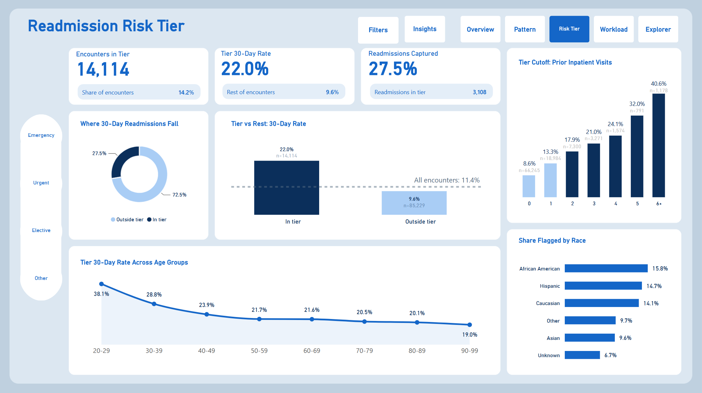
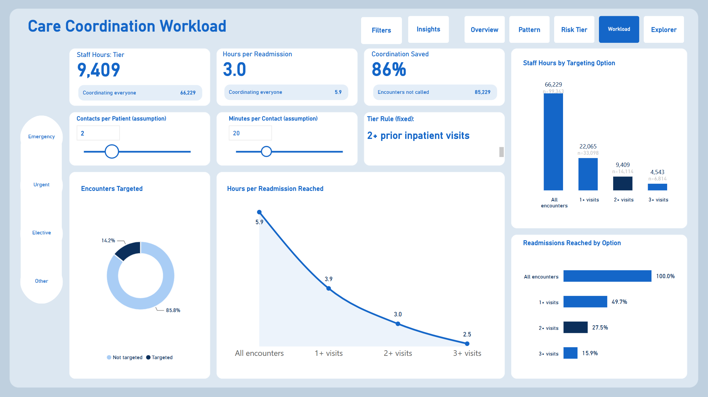

# Diabetic 30-Day Readmissions: Final Report

**Meridian Care Network (fictional) · Population Health**

## 1. Executive summary

**Context.** Meridian Care Network's quality committee has flagged diabetic readmissions again. The VP of Population Health asked for a way to identify patients at elevated risk before discharge, and a case for where to spend a limited care-coordination budget.

**Objective.** Measure the 30-day readmission rate, find the patterns associated with higher rates, and turn them into a simple flag the discharge planning team can use, with a cost in staff time.

**Key findings**

1. **11.4% of included encounters** (11,314 of 99,343) were readmitted within 30 days.
2. **Prior inpatient visits are the strongest signal.** The rate rises from 8.6% with no prior visits to 40.6% with six or more.
3. **Readmissions are concentrated.** Patients with two or more encounters are 23.4% of patients but account for 79.8% of readmissions.
4. **Most other factors show smaller differences.** Looked at one at a time, age, diagnosis group, admission type, medications and length of stay each move the rate by less than five points. Discharge destination shows a larger gap: a combined group of other discharge codes, which includes transfers to other hospitals and care facilities, had a 20.0% rate against 9.3% for those discharged home. This group mixes several types of discharge and needs breaking down before it can guide practice.

**Top recommendation.** Flag every encounter with **two or more prior inpatient visits** at discharge for care-coordination follow-up.

| | Flag 2+ prior visits | Contact everyone |
|---|---|---|
| Encounters to contact | 14,114 (14.2%) | 99,343 |
| Readmissions reached | 3,108 (27.5%) | 11,314 |
| Staff hours (2 contacts of 20 minutes) | 9,409 | 66,229 |
| Hours per readmission reached | **3.0** | 5.9 |

The tier's rate (22.0%) is **2.29 times** the rate of everyone else (9.6%), and the rule held up on patients it was not built on (2.07 times). **Illustrative impact:** if follow-up prevented one in ten readmissions in the tier, that would mean about **311 fewer readmissions** for 9,409 staff hours. This is an assumption to test, not a measured effect.

## 2. Project overview

### 2.1 Business problem

The stakeholder was clear that another chart showing the number going up would not help. The brief broke down into three questions:

| Need | Question |
|---|---|
| **Number** | How often are diabetic patients readmitted within 30 days? |
| **Pattern** | Which characteristics are associated with higher observed rates? |
| **Action** | How could the care-coordination team target its limited time? |

### 2.2 Defining the outcome

A readmission here means **a recorded return within 30 days of discharge** (`readmitted = "<30"`). Returns after 30 days are counted as not readmitted for this analysis, and are never merged into the 30-day group.

### 2.3 Data source

| | |
|---|---|
| Dataset | Diabetes 130-US Hospitals for Years 1999-2008, UCI Machine Learning Repository (Clore et al., 2014), CC BY 4.0 |
| Size | 101,766 encounters, 50 fields, 71,518 patients, 130 US hospitals |
| Lookup file | IDS_mapping.csv, with code tables for admission type, discharge disposition and admission source |
| Grain | **One row is one encounter, not one patient** |

The data is historical and de-identified. Findings are for analytical learning and do not describe any real organisation.

## 3. Methods

### 3.1 Pipeline

Raw data → clean data → questions → analysis → insights → recommendation.

| Stage | Tool | Output |
|---|---|---|
| Load | MySQL (`01_load_raw.sql`) | Text-only staging tables, exact copies of the files |
| Clean | MySQL (`02_clean.sql`) | Typed table, explicit missing values, 30-day readmission flag, exclusion flag, three lookup tables |
| Model | MySQL (`03_model.sql`) | Star schema (two fact tables and five dimensions), analysis bands, diagnosis groups and lookup coverage checks |
| Check | MySQL (`04_quality_checks.sql`) | Row counts, nulls and duplicates, all passing, then keys and indexes |
| Tier and validation | MySQL (`05_risk_tier.sql`) | Cutoff comparison, build and test validation, capture curve, workload |
| Analysis | MySQL (`06_analysis.sql`) | Ten exploratory questions |
| Statistics | Python in Google Colab (`eda_stats.ipynb`) | Summary statistics, correlation, significance test, validation check |
| Dashboard | Power BI | Power Query, DAX measures and five interactive pages |

SQL techniques include CTEs, window functions (`ROW_NUMBER`, `RANK`, `SUM OVER`), joins, `CASE`, `COALESCE`, casting, a `CROSS JOIN` unpivot, primary keys and indexes.

### 3.2 Key cleaning decisions

Full details are in `docs/cleaning_log.md`.

- **Exclusions:** 2,423 encounters were flagged and left out of rates: 1,652 where the patient died and 771 discharged to hospice. Patients who died cannot be readmitted, and hospice care has different goals, so both were treated as outside the scope of a readmission-prevention programme. Rows were flagged, not deleted.
- **"None" is not missing:** in the HbA1c field, "None" means the test was not done (83.1% of encounters). It was relabelled "Not tested".
- **Dropped fields:** weight (96.9% missing), examide and citoglipton (one value only).
- **Admission type 6:** labelled "NULL" in the lookup file, and relabelled "Not recorded" in Power Query. Together with "Not Available" and "Not Mapped", 10.2% of encounters have no usable admission type.
- **Medication table:** one row for each encounter and drug where the status is not "No" (120,054 rows). It includes excluded encounters, so they are filtered out where needed.
- **Outliers kept:** extreme prior-visit counts are plausible for frequent attenders, so they were kept and grouped into open-ended bands. The data does not allow them to be independently confirmed.
- **No dates:** `encounter_id` was used as a stand-in for visit order in one exploratory query (Q10). This has not been confirmed, so Q10 is not used in the findings.

### 3.3 Modelling choices

**Why a rule, not a model.** The stakeholder asked for something usable "on a Tuesday morning". A one-line rule based on a field already in the record can be applied at discharge without software, and anyone can check why a patient was flagged.

**Choosing the cutoff.** Patients were split by ID into a 70% build group and a 30% test group (`MOD(patient_nbr, 10) < 7`), so no patient appears in both. Cutoffs of 1+, 2+ and 3+ prior inpatient visits were compared in both groups. **2+ was chosen** as a balance between coverage and workload: it reaches over a quarter of readmissions while flagging about one encounter in seven. Because the cutoffs were compared in both groups, the test group is a consistency check rather than a fully independent test.

**Workload.** Staff hours assume two contacts of 20 minutes for each eligible discharge (encounter), so a patient with several stays is counted once for each discharge. Both values are adjustable on the dashboard's Workload page, where the contacts slider is labelled "contacts per patient" but applies to each discharge.

### 3.4 Limitations

- **Association, not causation.** The analysis shows which groups had higher observed rates, not why.
- **Historical data (1999 to 2008).** Current rates and practice may differ.
- **No dates,** so trends over time, including when any increase started, cannot be measured.
- **Recorded readmissions only.** Returns to hospitals outside the dataset may not be captured.
- **Encounters, not patients.** One patient can appear several times.
- **Repeat stays in the significance test.** The chi-square test and confidence intervals treat each encounter as independent, although some patients appear more than once, so they may overstate certainty. The patient-level 70/30 test split partly addresses this.
- **How the cutoff was chosen.** The test group is a consistency check, not a fully independent test (see 3.3).
- **Concentration is partly built in.** Patients who are readmitted naturally have more encounters on record.
- **Missing and grouped information.** Some fields are largely missing, and broad groups (such as the combined other-discharge group) can hide differences.
- **One factor at a time.** The comparisons do not show how factors combine, or whether a combined approach would target better.
- **Limited coverage.** 72.5% of readmissions fall outside the flagged group.
- **Workload is an estimate.** Hours cover the whole dataset rather than one year, and leave out administration and failed contact attempts. They estimate effort, not readmissions prevented.
- **The tier is not clinically validated.** It is an analytical flag, not a prediction model or a diagnosis.

## 4. Results

### 4.1 The number

| Measure | Value |
|---|---|
| Included encounters | 99,343 |
| Unique patients | 69,990 |
| 30-day readmissions | 11,314 |
| **30-day readmission rate** | **11.4%** |

### 4.2 The pattern

| Factor | Lowest group | Highest group | Spread |
|---|---|---|---|
| **Prior inpatient visits** | 0 visits: 8.6% | 6+ visits: 40.6% | **32.0 points** |
| **Discharge destination** | Home: 9.3% | Other discharge codes, including transfers: 20.0% | **10.7 points** |
| Length of stay | 1 to 2 days: 9.3% | 8 to 14 days: 13.8% | 4.5 points |
| Medications | 1 to 10: 9.2% | 21 to 30: 13.2% | 4.0 points |
| Diagnosis group | Musculoskeletal: 9.5% | Diabetes: 13.1% | 3.6 points |
| Age (30 to 99) | 50 to 59: 9.8% | 80 to 89: 12.6% | 2.8 points |
| Admission type | Elective: 10.5% | Emergency: 11.8% | 1.3 points |

Prior inpatient visits stand out by a wide margin, and the correlation analysis agrees: its Spearman correlation with readmission (0.14) is more than twice that of any other numeric field. On the Explorer page, flagged encounters have a higher rate than the rest **within every diagnosis group**.

Ten insights with their supporting queries are listed in `docs/eda_report.md`.

### 4.3 The risk tier

| Measure | Tier (2+ prior visits) | Everyone else |
|---|---|---|
| Encounters | 14,114 (14.2%) | 85,229 (85.8%) |
| Readmissions | 3,108 (27.5%) | 8,206 (72.5%) |
| 30-day rate | **22.0%** | **9.6%** |
| 95% confidence interval | 21.3% to 22.7% | 9.4% to 9.8% |

**Statistical significance.** The difference between the tier and everyone else is very unlikely to be chance (chi-square = 1,841.5, p < 0.001). The confidence intervals do not come close to overlapping. Both measures treat each encounter as independent (see 3.4).

**Validation on held-out patients**

| | Build group (70%) | Test group (30%) |
|---|---|---|
| Tier rate | 22.8% | 20.2% |
| Rest rate | 9.6% | 9.8% |
| Tier rate vs rest | 2.38 times | 2.07 times |
| Share of readmissions captured | 28.3% | 25.6% |

Performance drops a little on the test group, as expected, but the tier still identifies a group at roughly twice the risk of everyone else. The tier captures **1.94 times its share** of readmissions (27.5% of readmissions from 14.2% of encounters).

### 4.4 The workload

| Option | Encounters | Readmissions reached | Staff hours | Hours per readmission reached |
|---|---|---|---|---|
| Everyone | 99,343 | 100% | 66,229 | 5.9 |
| 1+ prior visits | 33,098 | 49.7% | 22,065 | 3.9 |
| **2+ prior visits** | **14,114** | **27.5%** | **9,409** | **3.0** |
| 3+ prior visits | 6,814 | 15.9% | 4,543 | 2.5 |

Each step up the cutoff makes the team's time more efficient but reaches fewer readmissions. The 2+ tier needs an estimated 86% fewer contact hours than contacting every encounter. The effect of follow-up on readmissions has not been tested.

### 4.5 Fairness

The tier uses no demographic fields, but that alone does not make it fair. Prior hospital use can differ between groups because of differences in need and in access to care, so the flag could reach some groups more than others. The share flagged by race and gender was not measured in this analysis. It should be measured on current local data before any pilot, and monitored throughout (see 5.2).

## 5. Action plan

### 5.1 Prioritised next steps

| Priority | Action | Owner | Timescale |
|---|---|---|---|
| 1 | Pilot the 2+ flag on one ward: add "inpatient stays in the last 12 months" to the discharge checklist | Discharge planning | 1 month |
| 2 | Give each flagged discharge two follow-up contacts within 30 days | Care coordination | During the pilot |
| 3 | Break down the combined other-discharge group by code, to see whether discharge destination could become a second prompt | Population Health analytics | Before the pilot |
| 4 | Compare pilot readmission rates with a similar ward not using the flag | Population Health analytics | 3 months |
| 5 | Roll out more widely, or move to the 1+ or 3+ option, depending on results and capacity | VP of Population Health | 6 months |

### 5.2 Monitoring plan

| What to track | How often | Warning sign |
|---|---|---|
| Share of discharges flagged | Monthly | Far from about 14% |
| Tier rate vs rest | Quarterly | Ratio falls well below 2 |
| Readmissions reached and staff hours used | Monthly | Hours per readmission reached rises above 3.0 |
| Share flagged by race and gender | Quarterly | Gaps widen, or flagged groups do not see better outcomes |
| Contacts actually completed | Monthly | Below 80% of flagged discharges |

### 5.3 Risks

| Risk | Mitigation |
|---|---|
| Patterns from 1999 to 2008 no longer hold | Re-run the analysis on current local data before rollout |
| The flag misses 72.5% of readmissions | Keep clinical judgement in the loop; staff can refer unflagged patients |
| Staff treat the flag as a diagnosis | Train staff that it prioritises follow-up only |
| Unequal flagging by group | Monitor quarterly and review the rule if gaps widen |
| Capacity is lower than assumed | Use the Workload page to switch to the 3+ option |

## 6. Ethics and privacy

- **De-identified data.** The dataset contains no names, addresses or dates. Patient and encounter IDs are anonymised numbers.
- **Licence.** Used under CC BY 4.0, with the source cited.
- **Purpose limitation.** The flag is for prioritising support, never for denying care or for decisions about individuals without clinical review.
- **Fairness.** The tier uses only prior hospital use, not race or gender, but its effects may still differ by group, so measurement and monitoring are built into the plan.
- **Transparency.** The rule is one line, the code is public in this repository, and anyone can check why a patient was flagged.
- **Real-world use.** Applying this to real patient data would need a data protection impact assessment, information governance approval and local clinical validation.

## 7. Conclusion

Diabetic readmissions in this data cluster among patients who have already been in hospital. A simple rule, two or more inpatient stays in the past year, picks out about one encounter in seven at more than twice the rate of encounters outside the flagged group, and would let a care-coordination team reach over a quarter of readmissions for about a seventh of the contact hours. The next step is to test it on current local data with a small pilot, measure the effect, and keep a close eye on fairness.

**Repository:** dashboard (`PowerBi/`), SQL (`sql/`), data dictionary, cleaning log and EDA report (`docs/`).
