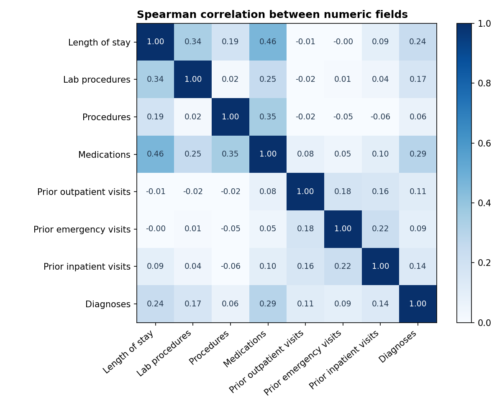

# Exploratory Data Analysis

All figures use the **99,343 included encounters** (expired and hospice discharges removed) unless stated otherwise. Queries are in `sql/06_analysis.sql`; summary statistics, correlations, the significance test and charts come from `notebooks/eda_stats.ipynb` (Python); field definitions are in `data_dictionary.md`.

## 1. Summary statistics

| Field | Mean | Median | Std dev | Min | Max | 99th percentile | Skew |
|---|---|---|---|---|---|---|---|
| Length of stay (days) | 4.38 | 4 | 2.97 | 1 | 14 | 14 | 1.14 |
| Lab procedures | 42.9 | 44 | 19.6 | 1 | 132 | 84 | -0.24 |
| Procedures | 1.33 | 1 | 1.70 | 0 | 6 | 6 | 1.32 |
| Medications | 16.0 | 15 | 8.09 | 1 | 81 | 43 | 1.34 |
| Prior outpatient visits | 0.37 | 0 | 1.27 | 0 | 42 | 5 | 8.84 |
| Prior emergency visits | 0.20 | 0 | 0.94 | 0 | 76 | 3 | 22.85 |
| Prior inpatient visits | 0.63 | 0 | 1.26 | 0 | 21 | 6 | 3.63 |
| Diagnoses | 7.40 | 8 | 1.94 | 1 | 16 | 9 | -0.86 |

**Outcome:** 11,314 of 99,343 encounters (11.39%) were readmitted within 30 days. The classes are imbalanced, so results are reported as rates and shares rather than raw counts.

## 2. Distributions

- **Length of stay** is right-skewed: most stays are 1 to 4 days, with a long tail to 14.
- **Medications** peak around 13 to 15 per encounter, with a tail past 40.
- **Prior inpatient visits** are heavily skewed: 66.7% of encounters have none. This is why a rule based on 2 or more visits flags only a small group.

## 3. Missing values

| Field | Missing % | Strategy |
|---|---|---|
| weight | 96.9 | Dropped |
| medical_specialty | 48.9 | Kept but not analysed |
| payer_code | 39.7 | Kept but not analysed |
| race | 2.2 | Labelled "Unknown"; used only for the fairness check |
| diag_2, diag_3 | 0.4, 1.4 | Kept; only diag_1 is used for grouping |
| admission_type_id | 10.2 (coded NULL, Not Available or Not Mapped) | Labelled "Not recorded" |

**Not missing, but easy to mistake for it:** "None" in A1Cresult (83.1%) and max_glu_serum (94.8%) means the test was not done. These were relabelled "Not tested" rather than treated as gaps.

## 4. Correlation and relationships

Spearman correlation was used because the numeric fields are skewed counts and the outcome is binary.

- **Prior inpatient visits has the strongest link to readmission (0.14)**, more than twice any other numeric field.
- Every other field is weak (0.06 or below). No single field explains readmission on its own, which is typical for this outcome.

- **Medications and length of stay move together (0.46):** longer stays tend to involve more drugs, so their patterns overlap and should not be read as two separate effects.
- The three prior-visit fields are only loosely related (0.16 to 0.22), so prior inpatient visits carries information the others do not.

## 5. Outliers

The IQR rule flags many values in the prior-visit fields (for example 11,094 in prior emergency visits), but only because most values are 0. Extreme values (up to 76 emergency visits) are plausible for frequent attenders, so **no rows were removed**. Instead, values were grouped into bands with an open top band ("6+", "31+"). See `cleaning_log.md`, Section 6.

## 6. Ten insights

| # | Insight | Evidence (06_analysis.sql) |
|---|---|---|
| 1 | About 1 in 9 included encounters was readmitted within 30 days | Q1: 11,314 of 99,343 (11.4%), from 69,990 patients |
| 2 | Readmissions are concentrated in returning patients | Q2: patients with 2+ encounters are 23.4% of patients but 79.8% of readmissions. Patients with 5+ are 2.2% of patients but 25.4% of readmissions |
| 3 | Prior inpatient visits are the strongest signal | Q3: 8.6% with none, 17.9% with 2, 40.6% with 6 or more |
| 4 | Age is a weak signal for adults | Q4: ages 30 to 99 range only from 9.8% to 12.6%. Under 20s look low but are small groups (160 and 690) |
| 5 | Diagnosis group spreads narrowly | Q5: 9.5% (Musculoskeletal) to 13.1% (Diabetes) |
| 6 | Admission type barely matters, and 10.2% of records lack it | Q6: Emergency 11.8%, Urgent 11.4%, Elective 10.5% |
| 7 | Discharge destination is the second strongest signal | Q7: Transferred to other care 20.0%, Nursing facility 14.7%, Home 9.3% |
| 8 | More medications, modestly higher rates | Q8: 9.2% (1 to 10) to 13.2% (21 to 30) |
| 9 | Longer stays, modestly higher rates | Q9: 9.3% (1 to 2 days) to 13.8% (8 to 14 days) |
| 10 | Risk builds with each return visit | Q10: 1st visit 9.0%, 2nd 14.2%, 3rd or later 20.9% |

**Supporting observations**

- Encounters with **no HbA1c test** had an 11.7% rate, against 9.9% for tested encounters.
- **Prior emergency visits** follow the same climb as inpatient visits: 10.7% with none, 18.8% with 2, 20.8% with 3.
- **Medication changed** during the stay: 12.0%, against 10.8% with no change.

All of these are **associations**. For example, "Encounters with longer stays had higher observed readmission rates", not "Longer stays cause readmission".
